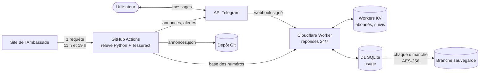

<div align="center">


[](https://t.me/passeport_paris_mg_bot)
[](https://github.com/Harrylepap/suivi-passeport-mg/actions/workflows/ci.yml)


<br>

Les listes de passeports prêts sont publiées en images, sans recherche ni alerte.<br>
Ce service les lit, les indexe et répond instantanément sur Telegram, sans serveur et sans frais.

</div>

<br>

## Le problème

L'Ambassade de Madagascar en France annonce les passeports disponibles en publiant des affiches : des images de tableaux contenant des numéros de quittance. Pour savoir si son passeport est arrivé, il faut revenir sur le site, ouvrir chaque affiche et parcourir les numéros à l'œil, parfois pendant des semaines.

## Ce que fait le service

Depuis le bot Telegram [@passeport_paris_mg_bot](https://t.me/passeport_paris_mg_bot), on peut :

- **savoir si son passeport est prêt** en envoyant son numéro de quittance, par exemple `2026-61191`. La réponse arrive aussitôt, avec l'affiche où figure le numéro ;
- **être prévenu plus tard** : un numéro pas encore publié est gardé en mémoire, et la personne reçoit un message le jour où il apparaît ;
- **recevoir chaque nouvelle publication**, avec les listes du jour et le rappel de la publication précédente.

| Commande            | Effet                                         |
|---------------------|-----------------------------------------------|
| `/start`            | Présente le service                           |
| `/derniere`         | Renvoie la dernière liste publiée             |
| `/suivis`           | Affiche les numéros suivis, avec leur retrait |
| `/confidentialite`  | Données enregistrées et droits                |
| `/stop`             | Désinscrit et efface toutes les données       |

Service bénévole, indépendant de l'Ambassade. Les [listes officielles](https://ambamad-paris.diplomatie.gov.mg/app/passeport/index.php/annonce) font foi.

## En chiffres

| | |
|---|---|
| Affiches indexées | 136, depuis novembre 2024 |
| Numéros de quittance lus | 3 099 |
| Numéros aberrants après lecture | de 232 à 1, grâce au prétraitement et au vote |
| Appels au site de l'Ambassade | 2 par jour, plus 2 téléchargements au plus par nouvelle affiche |
| Disponibilité du bot | 24 h sur 24, réponse immédiate |
| Tests automatisés | 24, dont la lecture complète de 3 affiches de référence |
| Coût d'exploitation | 0 € |

## Architecture



Le système est coupé en deux parties qui n'ont pas les mêmes besoins.

- **Le relevé** fait le travail lourd, une reconnaissance de caractères qui prend plusieurs secondes par image. Il tourne sur GitHub Actions, deux fois par jour : Tesseract y est disponible, le calcul est gratuit, et rien ne tourne entre deux passages.
- **Les réponses** doivent être immédiates et permanentes. Elles reviennent à un Worker Cloudflare, exécuté à la demande à chaque message, sans serveur à maintenir. Pour répondre, le Worker consulte la base déjà constituée, jamais les listes du site.

## Ingénierie

### Lire des numéros sur des images hétérogènes

Les affiches vont de l'export net en 1654 × 2339 à la capture d'écran de 670 pixels de large, avec cadre orange, tableaux à traits épais et polices variables. Tesseract appliqué tel quel ratait des listes entières et produisait des années impossibles, comme `2005-51700` au lieu de `2025-51700`.

La chaîne de lecture :

1. **Mise à l'échelle** de chaque image à trois largeurs : 1 800, 2 400 et 3 200 pixels.
2. **Binarisation** sur le canal le plus clair de chaque pixel, ce qui efface le cadre orange et le drapeau sans toucher au texte noir.
3. **Suppression des traits du tableau** : un pixel appartenant à une suite sombre horizontale ou verticale plus longue qu'un trentième de la largeur est effacé. Le calcul se fait par sommes cumulées NumPy, en temps linéaire, sans boucle Python.
4. **Six lectures** par affiche : trois tailles et deux modes de mise en page de Tesseract.
5. **Vote** : un numéro n'est retenu que si deux lectures au moins le donnent.

Le réglage a été choisi sur mesures, en comparant une vingtaine de variantes sur les 136 affiches. Les numéros aberrants, c'est-à-dire d'une année ou d'une longueur impossible, sont passés de 232 à 1. Trois affiches représentatives, contrôlées à l'œil, servent de tests de non-régression.

### Un Worker sans état et sans attente

- **Webhook authentifié** : Telegram signe chaque appel avec un secret partagé. Les routes réservées au relevé exigent un second secret.
- **Réponse immédiate** : le Worker accuse réception à Telegram tout de suite, puis traite le message en arrière-plan avec `waitUntil`.
- **Images téléversées une seule fois** : au premier envoi d'une affiche, Telegram renvoie un identifiant de fichier. Il est conservé, et les envois suivants le réutilisent sans retoucher le site de l'Ambassade.
- **Deux stockages, deux usages** : KV pour les abonnés et leurs numéros suivis, lus à chaque message ; D1, une base SQLite, pour les événements d'usage interrogeables en SQL.

### Une planification qui résiste aux retards

Les tâches planifiées de GitHub Actions sont assurées « au mieux » : un relevé prévu à 18 h UTC a été lancé un soir à 1 h 54. Le workflow est donc conçu pour tolérer ces retards :

- créneaux décalés de 7 minutes, pour éviter l'heure pile où la plateforme est saturée ;
- quatre créneaux UTC déclarés, pour couvrir l'heure d'été et l'heure d'hiver ;
- une garde qui juge le créneau prévu et non l'heure d'arrivée, si bien qu'un relevé en retard s'exécute quand même ;
- un relevé manqué n'a pas de conséquence : le suivant rattrape toutes les affiches parues entre-temps.

### Respect du site source

Chaque relevé fait un seul appel à l'interface qui alimente la page des annonces. Une affiche est téléchargée au plus deux fois dans toute sa vie : par le relevé pour la lire, puis par le Worker au premier affichage. Ensuite, Telegram la sert à partir de son identifiant de fichier, et le site n'est plus sollicité.

## Qualité et livraison

| Étape | Mise en œuvre |
|---|---|
| Tests du relevé | Titres, extraction des numéros, dates, regroupement par jour, lecture complète de 3 affiches de référence |
| Tests du Worker | 15 scénarios contre de faux KV, D1 et Telegram : recherche, suivi, effacement, purge, contrôle des accès |
| Intégration continue | À chaque envoi et à chaque demande de fusion |
| Release | Créée automatiquement sur `main` après les tests, avec ses notes de version |
| Déploiement | Migrations D1 appliquées, puis Worker publié et étiqueté du numéro de release |
| Alertes | Message Telegram à l'administrateur si un relevé, un déploiement ou une sauvegarde échoue, ou si une affiche est lue de façon suspecte |
| Observabilité | Journaux JSON du Worker, consultables dans Cloudflare |
| Dépendances | Versions figées : `requirements.txt`, `package-lock.json`, actions et image d'exécution |

## Données personnelles, dès la conception

- **Information** : la commande `/confidentialite` détaille les données enregistrées, leur usage et les droits de chacun.
- **Effacement** : `/stop` supprime aussitôt l'inscription, les numéros suivis, la fiche et tout l'historique de la personne.
- **Durée limitée** : sans message depuis 12 mois, les données d'une personne sont effacées automatiquement, et elle en est prévenue.
- **Sauvegardes chiffrées** : chaque dimanche, la base est exportée, chiffrée en AES-256 et déposée dans la branche `sauvegarde`. Seules les quatre dernières semaines sont gardées, sans historique.
- **Rien en clair dans ce dépôt public** : ni donnée d'utilisateur, ni secret.
- **Registre des traitements** tenu à jour : [docs/registre-des-traitements.md](docs/registre-des-traitements.md).

## Coût

| Ressource | Offre | Usage |
|---|---|---|
| Cloudflare Workers | Gratuite, 100 000 requêtes par jour | Quelques centaines |
| Cloudflare KV et D1 | Gratuite | Quelques mégaoctets |
| GitHub Actions | Gratuite pour un dépôt public | Deux relevés par jour, une sauvegarde par semaine |
| API Telegram | Gratuite, sans limite de messages | Toutes les notifications |
| **Total** | | **0 € par mois** |

## Structure du dépôt

```
check.py                             relevé, lecture des affiches, diffusion
annonces.json                        base des affiches et des numéros lus
requirements.txt                     dépendances Python, versions figées
tests/                               tests du relevé et affiches de référence
worker/src/index.js                  réponses aux messages (Worker Cloudflare)
worker/migrations/                   schéma de la base D1
worker/test/                         tests du Worker
worker/wrangler.toml                 configuration du Worker
analytics/requetes.sql               requêtes d'analyse d'usage
docs/registre-des-traitements.md     registre RGPD
.github/workflows/check.yml          relevé planifié
.github/workflows/ci.yml             tests, release et déploiement
.github/workflows/sauvegarde.yml     sauvegarde hebdomadaire chiffrée
.github/workflows/branche-cible.yml  contrôle de la branche des contributions
```

## Installer sa propre instance

Prérequis : un bot Telegram créé auprès de BotFather, un compte Cloudflare, un compte GitHub, Node.js, Python 3.11 ou plus récent, Tesseract.

1. **Créer le stockage et déployer le Worker**

   ```
   cd worker
   npx wrangler login
   npm ci
   npx wrangler kv namespace create passeport-bot
   npx wrangler d1 create passeport-bot
   ```

   Reporter les deux identifiants obtenus dans `wrangler.toml`, puis :

   ```
   npx wrangler d1 migrations apply passeport-bot --remote
   npx wrangler deploy
   ```

2. **Définir les secrets du Worker**

   ```
   npx wrangler secret put TELEGRAM_BOT_TOKEN
   npx wrangler secret put WEBHOOK_SECRET
   npx wrangler secret put ADMIN_SECRET
   ```

   `WEBHOOK_SECRET` et `ADMIN_SECRET` sont deux chaînes aléatoires. La première authentifie les appels de Telegram, la seconde ceux du relevé.

3. **Publier la base et brancher Telegram sur le Worker**

   Avec `TELEGRAM_BOT_TOKEN`, `WORKER_URL`, `ADMIN_SECRET` et `WEBHOOK_SECRET` dans l'environnement :

   ```
   pip install -r requirements.txt
   python check.py --publier
   python check.py --setup
   ```

4. **Configurer le dépôt GitHub**

   | Secret                  | Rôle                                                              |
   |-------------------------|-------------------------------------------------------------------|
   | `TELEGRAM_BOT_TOKEN`    | Jeton du bot                                                      |
   | `WORKER_URL`            | Adresse du Worker                                                 |
   | `ADMIN_SECRET`          | Secret partagé avec le Worker                                     |
   | `TELEGRAM_CHAT_ID`      | Conversation de l'administrateur, pour les alertes                |
   | `CLOUDFLARE_API_TOKEN`  | Jeton Cloudflare avec les droits Workers, KV et D1 en écriture    |
   | `SAUVEGARDE_PHRASE`     | Phrase secrète de chiffrement des sauvegardes                     |

   Et une variable, `CONTACT` : le pseudo Telegram affiché par `/confidentialite` pour les demandes RGPD.

Pour restaurer une sauvegarde dans une base vide :

```
openssl enc -d -aes-256-cbc -pbkdf2 -iter 600000 -in AAAA-MM-JJ.tar.gz.enc | tar -xzf -
cd worker
npx wrangler d1 execute passeport-bot --remote --file ../base.sql
```

Options de `check.py` :

| Option       | Effet                                                            |
|--------------|------------------------------------------------------------------|
| (aucune)     | Relevé complet : détection, lecture, publication, diffusion      |
| `--dry-run`  | Affiche les nouvelles affiches sans rien envoyer ni enregistrer  |
| `--publier`  | Envoie la base au Worker                                         |
| `--setup`    | Configure le webhook, le menu et la présentation du bot          |

## Contribuer

Les demandes de fusion se proposent sur la branche `develop`, voir [CONTRIBUTING.md](CONTRIBUTING.md).

## Licence

Code sous licence MIT, voir [LICENSE](LICENSE). Les listes et les images restent la propriété de l'Ambassade de Madagascar en France.

| Composant  | Usage                         | Licence           |
|------------|-------------------------------|-------------------|
| Tesseract  | Reconnaissance de caractères  | Apache 2.0        |
| Pillow     | Traitement des images         | MIT-CMU           |
| NumPy      | Calcul sur les pixels         | BSD 3 clauses     |
| Wrangler   | Déploiement du Worker         | MIT ou Apache 2.0 |


