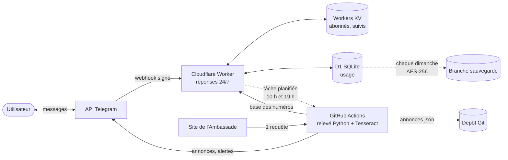
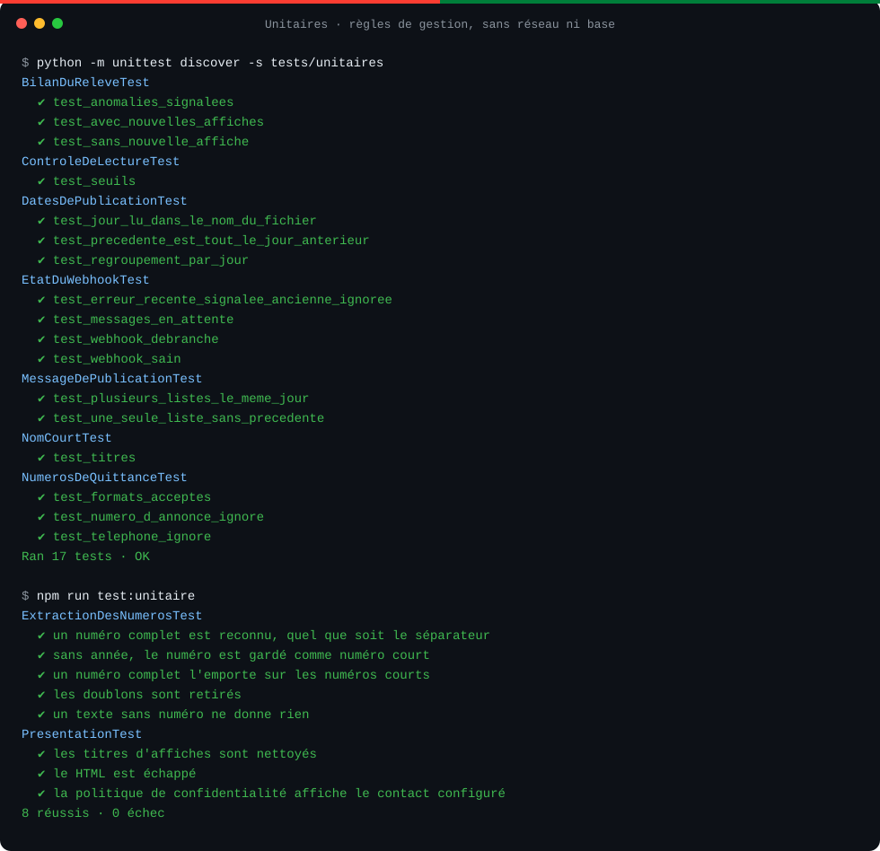
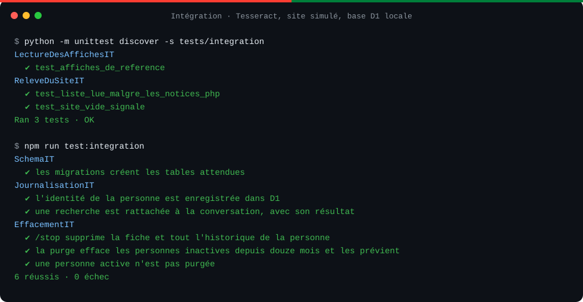
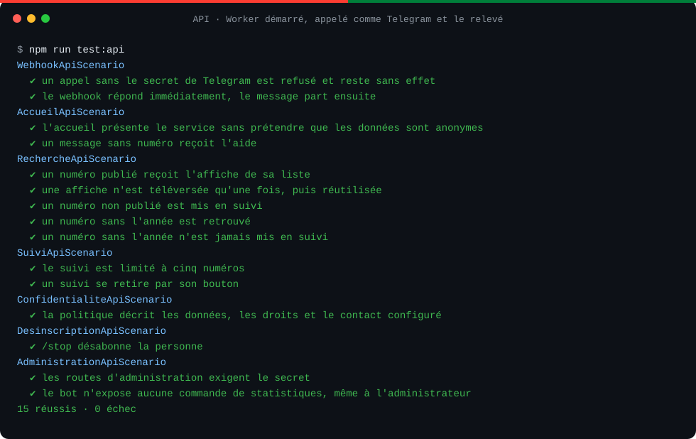
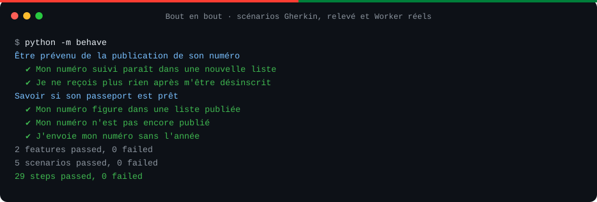

<div align="center">


[](https://t.me/passeport_paris_mg_bot)
[](https://github.com/Harrylepap/suivi-passeport-mg/actions/workflows/ci.yml)


[](https://github.com/Harrylepap/suivi-passeport-mg/wiki)


<br>

Les listes de passeports prêts sont publiées en images, sans recherche ni alerte.<br>
Ce service les lit, les indexe et répond instantanément sur Telegram, sans serveur et sans frais.

</div>

<br>

## Le problème

L'Ambassade de Madagascar en France annonce les passeports disponibles en publiant des affiches : des images de tableaux contenant des numéros de quittance. Pour savoir si son passeport est arrivé, il faut revenir sur le site, ouvrir chaque affiche et parcourir les numéros à l'œil, parfois pendant des semaines.

## Ce que fait le service

Depuis le bot Telegram [@passeport_paris_mg_bot](https://t.me/passeport_paris_mg_bot), on peut :

- **savoir si son passeport est prêt** en envoyant son numéro de quittance, par exemple `2026-61191`. La réponse arrive aussitôt, avec l'affiche où figure le numéro ;
- **être prévenu plus tard** : un numéro pas encore publié est gardé en mémoire, et la personne reçoit un message le jour où il apparaît ;
- **recevoir chaque nouvelle publication**, avec les listes du jour et le rappel de la publication précédente.

Service bénévole, indépendant de l'Ambassade. Les [listes officielles](https://ambamad-paris.diplomatie.gov.mg/app/passeport/index.php/annonce) font foi. Mode d'emploi complet dans le [wiki](https://github.com/Harrylepap/suivi-passeport-mg/wiki/01-Utiliser-le-bot).

## En chiffres

| | |
|---|---|
| Affiches indexées | 136, depuis novembre 2024 |
| Numéros de quittance lus | 3 099 |
| Numéros aberrants après lecture | de 232 à 1, grâce au prétraitement et au vote |
| Appels au site de l'Ambassade | 2 par jour, plus 2 téléchargements au plus par nouvelle affiche |
| Disponibilité du bot | 24 h sur 24, réponse immédiate |
| Tests automatisés | 59 sur quatre niveaux, de la règle de gestion au parcours complet en Gherkin |
| Coût d'exploitation | 0 € |

## Architecture



Le système est coupé en deux parties qui n'ont pas les mêmes besoins.

- **Le relevé** fait le travail lourd, une reconnaissance de caractères qui prend plusieurs secondes par image. Il tourne sur GitHub Actions, deux fois par jour : Tesseract y est disponible, le calcul est gratuit, et rien ne tourne entre deux passages.
- **Les réponses** doivent être immédiates et permanentes. Elles reviennent à un Worker Cloudflare, exécuté à la demande à chaque message, sans serveur à maintenir. Pour répondre, le Worker consulte la base déjà constituée, jamais les listes du site.

## Déroulé

Une recherche, du message de l'utilisateur à la réponse :

<p align="center"></p>

Un relevé, de la détection d'une affiche à l'alerte des personnes concernées :

<p align="center"></p>

## Ingénierie

### Lire des numéros sur des images hétérogènes

Les affiches vont de l'export net en 1654 × 2339 à la capture d'écran de 670 pixels de large, avec cadre orange, tableaux à traits épais et polices variables. Tesseract appliqué tel quel ratait des listes entières et produisait des années impossibles, comme `2005-51700` au lieu de `2025-51700`.

La chaîne de lecture :

1. **Mise à l'échelle** de chaque image à trois largeurs : 1 800, 2 400 et 3 200 pixels.
2. **Binarisation** sur le canal le plus clair de chaque pixel, ce qui efface le cadre orange et le drapeau sans toucher au texte noir.
3. **Suppression des traits du tableau** : un pixel appartenant à une suite sombre horizontale ou verticale plus longue qu'un trentième de la largeur est effacé. Le calcul se fait par sommes cumulées NumPy, en temps linéaire, sans boucle Python.
4. **Six lectures** par affiche : trois tailles et deux modes de mise en page de Tesseract.
5. **Vote** : un numéro n'est retenu que si deux lectures au moins le donnent.

Le réglage a été choisi sur mesures, en comparant une vingtaine de variantes sur les 136 affiches. Les numéros aberrants, c'est-à-dire d'une année ou d'une longueur impossible, sont passés de 232 à 1. Trois affiches représentatives, contrôlées à l'œil, servent de tests de non-régression.

### Un Worker sans état et sans attente

- **Webhook authentifié** : Telegram signe chaque appel avec un secret partagé. Les routes réservées au relevé exigent un second secret.
- **Réponse immédiate** : le Worker accuse réception à Telegram tout de suite, puis traite le message en arrière-plan avec `waitUntil`.
- **Images téléversées une seule fois** : au premier envoi d'une affiche, Telegram renvoie un identifiant de fichier. Il est conservé, et les envois suivants le réutilisent sans retoucher le site de l'Ambassade.
- **Deux stockages, deux usages** : KV pour les abonnés et leurs numéros suivis, lus à chaque message ; D1, une base SQLite, pour les événements d'usage interrogeables en SQL.

### Un réveil à l'heure

Le relevé était d'abord confié au planificateur de GitHub Actions. Mesuré sur trois jours, celui-ci l'a lancé avec 7 à 9 heures de retard : la liste de l'après-midi annoncée au milieu de la nuit. GitHub ne garantit aucune heure aux tâches planifiées, et place les dépôts peu actifs en fin de file.

Le réveil a donc changé de main. Une tâche planifiée du Worker Cloudflare, ponctuelle à la minute, lance le workflow GitHub par son API. Le relevé lui-même ne bouge pas : il tourne toujours sur GitHub, avec Tesseract.

- un seul déclencheur, déclaré à 8 h, 9 h, 17 h et 18 h UTC ; le Worker ne retient que les créneaux qui tombent à 10 h ou 19 h à Paris, été comme hiver ;
- un jeton GitHub limité à ce dépôt et au seul droit de lancer des workflows ;
- si GitHub refuse le lancement, l'administrateur est prévenu sur Telegram ;
- un relevé manqué reste sans conséquence : le suivant rattrape toutes les affiches parues entre-temps.

### Respect du site source

Chaque relevé fait un seul appel à l'interface qui alimente la page des annonces. Une affiche est téléchargée au plus deux fois dans toute sa vie : par le relevé pour la lire, puis par le Worker au premier affichage. Ensuite, Telegram la sert à partir de son identifiant de fichier, et le site n'est plus sollicité.

## Tests

La stratégie suit celle de mon [engineering playbook](https://github.com/Harrylepap/engineering-playbook/blob/main/03-tester.md) : chaque niveau répond à une seule question.

| Niveau | La question | Ce qu'il touche | Tests |
|---|---|---|---|
| Unitaire `*Test` | Cette règle de gestion est-elle juste ? | Une fonction, sans réseau ni base | 30 |
| Intégration `*IT` | Ce composant parle-t-il correctement à ses dépendances ? | Tesseract réel, site simulé, base D1 locale | 9 |
| API `*ApiScenario` | Le contrat tient-il, vu de l'extérieur ? | Le Worker démarré, appelé comme Telegram l'appelle | 15 |
| Bout en bout | Le parcours utilisateur fonctionne-t-il ? | Relevé, lecture des affiches et Worker réels | 5 scénarios Gherkin |

Trois règles, sans exception :

- **boîte noire au-dessus de l'unitaire** : les scénarios d'API et de bout en bout parlent au bot comme Telegram, et observent ce que Telegram reçoit, sans jamais lire la base ;
- **aucune donnée préchargée** : chaque test part d'une base vide et crée ce dont il a besoin par les chemins d'un vrai client ;
- **le même test, partout** : seules les adresses du site, de Telegram et du Worker changent, par variables d'environnement.

Les critères d'acceptation s'écrivent en Gherkin et s'exécutent tels quels :

```gherkin
Fonctionnalité: Être prévenu de la publication de son numéro

  Scénario: Mon numéro suivi paraît dans une nouvelle liste
    Étant donné que l'Ambassade a publié les listes "BEG 2025-016"
    Et que le relevé est passé
    Et que j'ai envoyé "2026-61191" au bot
    Quand l'Ambassade publie la liste "BEG 2026-066"
    Et que le relevé passe
    Alors je reçois l'annonce "Nouvelle liste publiée le 24/11/2026"
    Et l'annonce rappelle la publication précédente du "16/05/2025"
    Et je reçois l'alerte "2026-61191 est publié"
```

Dans ce scénario, rien n'est factice côté service : le vrai relevé interroge un site simulé, Tesseract lit la vraie affiche, le vrai Worker répond avec une vraie base, et un faux Telegram enregistre ce que l'utilisateur aurait reçu.

### Exécution réelle

<p align="center"></p>
<p align="center"></p>
<p align="center"></p>
<p align="center"></p>

## Livraison

```
Unitaires ──┬── Intégration ──┐
            └── API ──────────┴── Bout en bout ── Release ── Déploiement
```

| Étape | Mise en œuvre |
|---|---|
| Intégration continue | Les quatre niveaux à chaque envoi et à chaque demande de fusion, les plus rapides d'abord |
| Couverture | Affichée dans le résumé de chaque exécution, pour trouver les angles morts, sans seuil imposé |
| Release | Créée sur `main` seulement si les quatre niveaux réussissent, avec ses notes de version |
| Déploiement | Migrations D1 appliquées, puis Worker publié et étiqueté du numéro de release |
| Alertes | Message Telegram à l'administrateur si un relevé, un déploiement ou une sauvegarde échoue, ou si une affiche est lue de façon suspecte |
| Bilan | À chaque relevé, un message à l'administrateur : nouvelles affiches, état du Worker et du webhook Telegram. Son absence signale un relevé qui n'a pas tourné |
| Observabilité | Journaux JSON du Worker, consultables dans Cloudflare |
| Dépendances | Versions figées : `requirements.txt`, `requirements-dev.txt`, `package-lock.json`, actions et image d'exécution |

## Données personnelles, dès la conception

- **Information** : la commande `/confidentialite` détaille les données enregistrées, leur usage et les droits de chacun.
- **Effacement** : `/stop` supprime aussitôt l'inscription, les numéros suivis, la fiche et tout l'historique de la personne.
- **Durée limitée** : sans message depuis 12 mois, les données d'une personne sont effacées automatiquement, et elle en est prévenue.
- **Sauvegardes chiffrées** : chaque dimanche, la base est exportée, chiffrée en AES-256 et déposée dans la branche `sauvegarde`. Seules les quatre dernières semaines sont gardées, sans historique.
- **Rien en clair dans ce dépôt public** : ni donnée d'utilisateur, ni secret.
- **Registre des traitements** tenu à jour : [docs/registre-des-traitements.md](docs/registre-des-traitements.md).

## Coût

| Ressource | Offre | Usage |
|---|---|---|
| Cloudflare Workers | Gratuite, 100 000 requêtes par jour | Quelques centaines |
| Cloudflare KV et D1 | Gratuite | Quelques mégaoctets |
| GitHub Actions | Gratuite pour un dépôt public | Deux relevés par jour, une sauvegarde par semaine |
| API Telegram | Gratuite, sans limite de messages | Toutes les notifications |
| **Total** | | **0 € par mois** |

## Pour aller plus loin

Le [wiki](https://github.com/Harrylepap/suivi-passeport-mg/wiki) détaille chaque brique et la façon d'exploiter le service :

| Page | La question qu'elle traite |
|---|---|
| [Lire les affiches](https://github.com/Harrylepap/suivi-passeport-mg/wiki/03-Lire-les-affiches) | Comment extraire des numéros fiables d'images hétérogènes ? |
| [Le Worker](https://github.com/Harrylepap/suivi-passeport-mg/wiki/04-Le-Worker) | Comment répondre instantanément, sans serveur ? |
| [Le relevé](https://github.com/Harrylepap/suivi-passeport-mg/wiki/05-Le-releve) | Comment surveiller le site deux fois par jour sans le solliciter ? |
| [Exploiter](https://github.com/Harrylepap/suivi-passeport-mg/wiki/08-Exploiter) | Que faire quand quelque chose ne va pas ? |
| [Décisions](https://github.com/Harrylepap/suivi-passeport-mg/wiki/10-Decisions) | Pourquoi les choses sont-elles ainsi ? |
| [Installer](https://github.com/Harrylepap/suivi-passeport-mg/wiki/11-Installer) | Comment faire tourner sa propre instance ? |

## Licence

Code sous licence MIT. Les listes et les images restent la propriété de l'Ambassade de Madagascar en France. Contributions sur la branche `develop`, voir [CONTRIBUTING.md](CONTRIBUTING.md).
